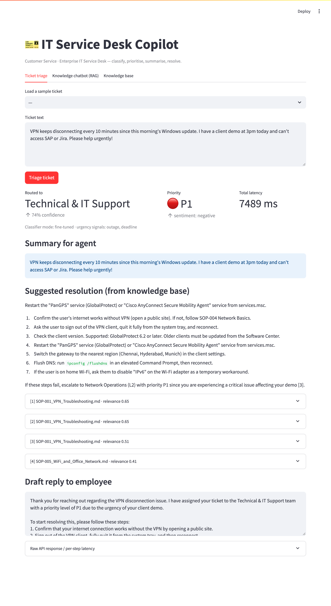

# IT Service Desk Copilot

**Domain:** Customer Service – Enterprise IT Service Desk · **Category:** NLP
**Goal:** cut ticket resolution time by routing, prioritising, summarising and answering IT tickets automatically, exposed as a REST API with a web UI.

> New here? Start with **[FOR_TEAMMATES.md](FOR_TEAMMATES.md)** — 15-minute setup.



## Results at a glance

| Component | Result |
|---|---|
| Ticket router (fine-tuned RoBERTa, 6 routing groups) | **55.3%** accuracy vs 32.3% zero-shot baseline · **11 ms** per ticket vs 206 ms |
| RAG chatbot (40-question evaluation) | Right document first **97%** · expected fact in answer **91%** (94% after manual review) · faithfulness **4.7/5** · out-of-scope questions declined **6/6** |
| Full `/triage` pipeline | ~5 s per ticket, almost all in the two LLM calls |

## Sub-tasks → one goal

| # | Sub-task | Model | Type | Endpoint |
|---|---|---|---|---|
| 1 | Ticket routing | `roberta-base` **fine-tuned** (baseline: `facebook/bart-large-mnli` zero-shot) | SLM | `POST /api/v1/classify` |
| 2 | Sentiment + P1/P2/P3 urgency | `cardiffnlp/twitter-roberta-base-sentiment-latest` + urgency rules | SLM | `POST /api/v1/sentiment` |
| 3 | Summarisation | `sshleifer/distilbart-cnn-12-6` (tickets < 40 words pass through) | SLM | `POST /api/v1/summarize` |
| 4 | Resolution Q&A (RAG) | `all-MiniLM-L6-v2` + BM25 hybrid retrieval + ChromaDB + `gpt-4o-mini` | SLM + LLM | `POST /api/v1/chat`, `POST /api/v1/ingest` |
| 5 | Reply drafting | `gpt-4o-mini` | LLM | inside `/triage` |
| ★ | **Unified pipeline** 1 → 2 → 3 → 4 → 5, with per-step latency | | | `POST /api/v1/triage` |

```
Streamlit UI (:8501) ──HTTP──► FastAPI (:8000)   Swagger: /docs · health: /health
                                ├─ classifier  fine-tuned RoBERTa  (fallback: zero-shot BART)
                                ├─ sentiment   RoBERTa + urgency rules (outage, deadline, scope, security)
                                ├─ summarizer  DistilBART
                                ├─ rag         section-aware chunks → MiniLM + BM25 (RRF fusion) → gpt-4o-mini with [n] citations
                                └─ reply       gpt-4o-mini
```

Graceful fallbacks: no fine-tuned model → zero-shot router; no LLM key → the chatbot returns the best-matching document excerpt.

## Quick start

```bash
python -m venv .venv && source .venv/bin/activate        # Windows: .venv\Scripts\activate
pip install -r backend/requirements.txt -r frontend/requirements.txt -r requirements-dev.txt
cp backend/.env.example backend/.env                      # paste YOUR OWN key (OpenAI, Groq or Ollama)
python scripts/ingest_kb.py                               # loads data/kb/* into the vector store
cd backend && uvicorn app.main:app --port 8000            # terminal 1 → http://localhost:8000/docs
streamlit run frontend/app.py                             # terminal 2, repo root → http://localhost:8501
pytest -q                                                 # fast tests, models stubbed
```

- The fine-tuned router is loaded from `finetune/outputs/v2_6cls_merged/` if present (shared separately as `router-model-v2.zip`), else `distilbert-ticket-queue/`; override with `CLASSIFIER_MODEL` in `backend/.env`.
- First run downloads ~1.5 GB of Hugging Face models; send one request before a live demo.
- **Docker:** `docker compose up --build` → UI :8501, API :8000/docs.
- **Never commit or share `backend/.env`** — it holds your API key (already in `.gitignore`).

## Fine-tuning (Section II)

Dataset: [`Tobi-Bueck/customer-support-tickets`](https://huggingface.co/datasets/Tobi-Bueck/customer-support-tickets) (English tickets, CC BY-NC 4.0, academic use). Run `finetune/finetune_colab_v2.ipynb` on a free Colab T4 GPU (upload `finetune_v2_colab.zip`), or:

```bash
pip install -r finetune/requirements.txt
python finetune/prepare_data.py --run v2_6cls_merged --merge          # clean, dedupe, merge overlapping queues
python finetune/train_classifier.py --run v2_6cls_merged --base roberta-base --epochs 5 --lr 2e-5
python finetune/evaluate.py --run v2_6cls_merged                      # zero-shot vs fine-tuned → finetune/results/<run>/
```

| Run | Model | Classes | Zero-shot | Fine-tuned | Macro-F1 |
|---|---|---|---|---|---|
| v1 | DistilBERT, capped data | 8 | 23.5% | 41.6% | 0.42 |
| v2-A | RoBERTa, full data | 8 | 19.8% | 42.8% | 0.45 |
| **v2-B (used)** | RoBERTa, full data | 6 merged | 32.3% | **55.3%** | **0.52** |

v1 scripts are kept in `finetune/v1_scripts/`; all runs are summarised in `finetune/results/all_runs_summary.csv`.

## RAG (Section III)

- **Knowledge base:** 13 synthetic IT SOPs and policies in `data/kb/` (61 chunks). Add more via the UI's **Knowledge base** tab or `POST /api/v1/ingest` (PDF, DOCX, MD, TXT).
- **Retrieval:** chunks carry `"<document> > <section>"` headers; dense (MiniLM) and BM25 rankings are fused with Reciprocal Rank Fusion; top 4 go to the LLM; best cosine < 0.15 → decline without calling the LLM.
- **Evaluation:** `python scripts/eval_rag.py --answers` runs 40 questions (26 direct, 8 distractor, 6 out-of-scope) and grades answers with an LLM judge → `finetune/results/rag/`. v1 results are in `finetune/results/rag_v1/`.

| Metric | v1 | v2 |
|---|---|---|
| Retrieval hit@1 | 91.2% | **97.1%** |
| Answer contains expected fact | 79.4% | **91.2%** |
| Faithfulness (1–5) | 4.24 | **4.71** |
| In-scope questions wrongly declined | 6/34 | **2/34** |
| Out-of-scope questions declined | 6/6 | **6/6** |

## Screenshots and workplace demo (Section IV)

`python scripts/capture_screenshots.py` (needs `pip install playwright && playwright install chromium`, app running) saves every report screenshot plus the raw API responses to `docs/screenshots/`. Synthetic workplace documents for the Section IV demo are in `data/workplace/`.

## Deploy to Hugging Face Spaces (optional)

One container: nginx on `:7860` serves the UI at `/` and the API at `/docs`, `/api/v1/*`, `/health`.

```bash
pip install huggingface_hub && huggingface-cli login       # token with WRITE scope
python deploy/push_to_space.py <hf-user>/servicedesk-copilot
```

In the Space settings add the secret `LLM_API_KEY` and variables `LLM_BASE_URL`, `LLM_MODEL`; push the router to the Hub (last cell of the v2 notebook) and set `CLASSIFIER_MODEL=<hf-user>/<model-repo>`. GitHub Actions (`.github/workflows/ci.yml`) runs the tests and a Docker build on every push.

## Repo map

```
backend/app/          FastAPI app: config, schemas (API contract), routers/, services/
frontend/app.py       Streamlit UI (triage · chatbot · knowledge-base upload)
finetune/             data prep, training, evaluation, Colab notebooks, results/
data/kb/              13 synthetic IT SOPs and policies (RAG knowledge base)
data/workplace/       synthetic workplace documents for Section IV
data/rag_eval.json    40-question RAG evaluation set
scripts/              ingest_kb.py, eval_rag.py, capture_screenshots.py, warmup.py
docs/screenshots/     report screenshots + raw API responses
deploy/               Hugging Face Spaces (Dockerfile, nginx, start script, push script)
tests/                pytest suite
FOR_TEAMMATES.md      setup guide for team members
```
